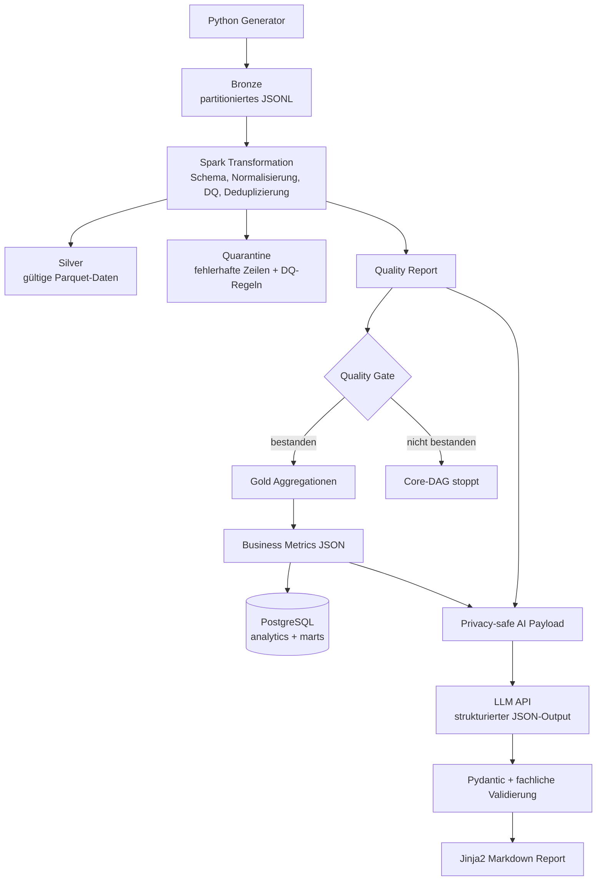
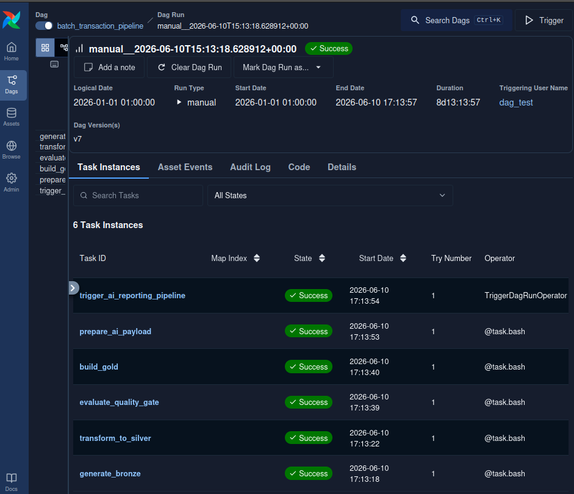
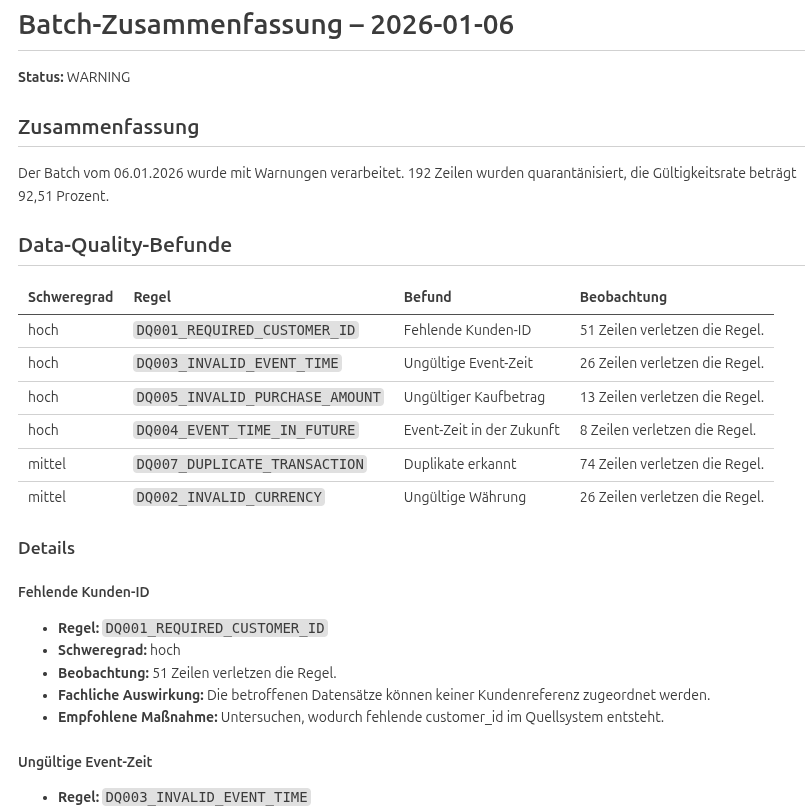

# Batch-Transaktionsdaten-Verarbeitung

[](https://github.com/Jakob-Benjamin-Dorn/Batch_Transaktionsdaten_Verarbeitung/actions/workflows/ci.yml)


Ein Data-Engineering-/Analytics-Engineering-Projekt für eine reproduzierbare Batch-Datenpipeline u.a. mit Python, Apache Spark, Apache Airflow, Docker und einer strukturierten KI-Zusammenfassung.

Das Projekt entstand aus der Motivation, einen vollständigen Data-Engineering-Workflow praktisch umzusetzen und ihn nachvollziehbar zu machen: von synthetischen Finanztransaktions-Rohdaten über Data Quality und schema-orientierter Medallion-Architektur bis hin zur Bewertung anhand eines Datenvertrages und Berichterstellung samt datenschutzkonformer KI-Anbindung für automatisierte Business-Reports.

## Architektur



## Beispielergebnis

### Airflow-Orchestrierung


*Der Core-DAG verarbeitet die deterministischen Pipeline-Schritte und startet anschließend den separaten KI-DAG.*


### Generierter KI-Report



*Der finale Markdown-Bericht wird aus einem validierten JSON-Output erzeugt. Die externe KI erhält ausschließlich aggregierte Kennzahlen und Data-Quality-Metriken.*


## Airflow-DAGs

### 1. Core-DAG: `batch_transaction_pipeline`

```text
generate_bronze
→ transform_to_silver
→ evaluate_quality_gate
→ build_gold
→ load_to_postgres
→ prepare_ai_payload
→ trigger_ai_reporting_pipeline
```

Der Core-DAG enthält die deterministischen Datenverarbeitungsschritte. Er kann erfolgreich abgeschlossen werden, sobald der separate KI-DAG gestartet wurde.

### 2. KI-DAG: `ai_reporting_pipeline`

Der KI-DAG erstellt die KI-Zusammenfassung und rendert sie als Markdown. Der KI-Teil ist bewusst vom Core-DAG getrennt. Ist die externe API vorübergehend nicht erreichbar, werden nur die KI-Tasks wiederholt oder als fehlgeschlagen markiert. Bronze-, Silver-, Quarantine- und Gold-Daten bleiben davon unberührt.

Der Core-DAG verwendet:

```python
schedule="@daily"
catchup=False
max_active_runs=1
```

Dadurch werden beim ersten Aktivieren nicht automatisch alle historischen Tagesintervalle seit dem Startdatum nachgeholt.

## Warum diese Technologien?

**Docker**: Airflow, Spark, Java und Python-Abhängigkeiten lokal konsistent zu betreiben ist potenziell fehleranfällig. Docker stellt eine reproduzierbare Laufzeitumgebung bereit, ohne dass Python, Java, Spark oder Airflow auf dem Host installiert sein müssen. Quellcode und Konfiguration werden read-only eingebunden. Veränderliche Daten, Logs und Airflow-Zustände liegen in Named Volumes. Ein kurzlebiger `airflow-init`-Container richtet die Volumes als Root ein; der eigentliche Airflow-Service läuft anschließend unprivilegiert.

**Apache Spark**: Für die derzeitige Datenmenge würde Pandas ausreichen. Spark wird bewusst verwendet, um eine skalierbare, schemaorientierte Verarbeitung mit getrennten Daten-Layern zu demonstrieren.

**Apache Airflow**: Airflow übernimmt Scheduling, Reihenfolge, Retries, Laufhistorie und Fehlerstatus. Die fachliche Logik bleibt in eigenständigen, testbaren CLI-Skripten. Die DAGs verwenden die moderne decorator-basierte TaskFlow-Schreibweise.

### KI-Zusammenfassung

Das LLM berechnet keine Kennzahlen und entscheidet nicht über Datenqualität. Spark und das Quality Gate liefern die Fakten. Die KI formuliert ausschließlich eine strukturierte Zusammenfassung aus aggregierten Metriken.

Der Ablauf ist wie folgt kontrolliert:

```text
aggregierte Reports
→ feste Allowlist
→ LLM mit JSON-Ausgabe
→ Pydantic-Validierung
→ fachliche Validierung
→ Jinja2-Markdown
```

Der Provider ist perspektivisch austauschbar. Aktuell wird DeepSeek verwendet; ein Vergleich mit anderen Modellen wie z.B. Mistral ist als spätere Erweiterung vorgesehen.

## Datenschutz

An die externe API werden keine Rohzeilen oder individuellen Identifikatoren übermittelt. Nicht freigegeben sind unter anderem: `transaction_id`, `customer_id`, `merchant_id`, `device_id`, einzelne Zeitstempel oder Beiträge.

Erlaubt sind ausschließlich aggregierte Kennzahlen, Regelbeschreibungen und technische Data-Quality-Metriken. Eine feste Allowlist sorgt dafür, dass neue Felder nicht automatisch in das KI-Payload gelangen. Zudem werden API-Schlüssel ausschließlich über Umgebungsvariablen bereitgestellt und nicht in Git gespeichert.

Für einen produktiven Einsatz müsste außerdem zusätzlich geprüft werden, ob die Nutzung des gewählten KI-Anbieters mit internen Compliance-Vorgaben, Datenschutzrecht, branchenspezifischen Anforderungen und dem EU AI Act vereinbar ist.

## Medallion- und Report-Struktur

```text
/opt/airflow/data/
├── bronze_raw/
├── silver_processed/
├── quarantine/
├── gold_analytics/
└── reports/
```

Für einen erfolgreichen Tageslauf entstehen beispielsweise:

```text
reports/year=2026/month=01/day=02/
├── quality_report.json
├── business_metrics.json
├── ai_input_payload.json
├── ai_summary.json
└── ai_summary.md
```

## Projektstruktur

```text
.
├── airflow/
│   └── dags/
│       ├── batch_transaction_pipeline.py
│       └── ai_reporting_pipeline.py
├── src/
│   ├── generator/
│   │   └── generate_transactions.py
│   ├── spark/
│   │   ├── schemas.py
│   │   ├── data_quality.py
│   │   ├── transform_transactions.py
│   │   ├── evaluate_quality_gate.py
│   │   └── build_gold.py
│   ├── common/
│   │   └── dates.py
│   ├── analytics/
│   │   └── load_to_postgres.py
│   └── ai_summary/
│       ├── prepare_payload.py
│       ├── models.py
│       ├── prompts.py
│       ├── create_ai_summary.py
│       ├── render_summary.py
│       └── templates/
│           └── summary.md.j2
├── sql/
│   └── init/
│       ├── 001_create_schemas.sql
│       └── 002_create_gold_tables.sql
├── knowledge_base/
│   └── data_contract.json
├── tests/
│   ├── unit/
│   ├── integration/
│   └── dags/
├── Dockerfile
├── docker-compose.yml
├── requirements.txt
└── .env.example
```

## Voraussetzungen

- Git
- Docker
- Docker Compose

## Schnellstart

### Repository klonen

```bash
git clone https://github.com/Jakob-Benjamin-Dorn/Batch_Transaktionsdaten_Verarbeitung.git
cd Batch_Transaktionsdaten_Verarbeitung
```

### Umgebungsvariablen

```bash
cp .env.example .env
```

Danach den API-Key ausschließlich lokal in `.env` ergänzen.

### Image bauen und Services starten

```bash
docker compose up --build -d
```

Bei späteren Starts ohne geänderte Abhängigkeiten:

```bash
docker compose up -d
```

Airflow ist anschließend erreichbar unter:

```text
http://localhost:8080
```
Der Port wird im Code bewusst nur an `127.0.0.1` gebunden, damit die lokale Airflow-UI nicht im Netzwerk freigegeben wird. 

Beim lokalen Airflow-Setup mit Simple Auth Manager können die erzeugten Zugangsdaten beispielsweise so eingesehen werden:

```text
docker compose exec airflow \
  cat /opt/airflow/state/simple_auth_manager_passwords.json
```

### DAGs aktivieren

```bash
docker compose exec airflow \
  airflow dags unpause batch_transaction_pipeline
```

```bash
docker compose exec airflow \
  airflow dags unpause ai_reporting_pipeline
```

### Core-DAG für einen historischen Tag starten

Verwende ein Datum, für das noch kein DAG-Run existiert:

```bash
docker compose exec airflow \
  airflow dags trigger \
  --logical-date 2026-01-03T00:00:00+00:00 \
  batch_transaction_pipeline
```

### Runs kontrollieren

```bash
docker compose exec airflow \
  airflow dags list-runs batch_transaction_pipeline
```

```bash
docker compose exec airflow \
  airflow dags list-runs ai_reporting_pipeline
```

## Manuelle Ausführung einzelner Stufen

Die Pipeline wird normalerweise über Airflow gestartet. Die einzelnen CLI-Skripte können bei Bedarf auch direkt im Container ausgeführt werden.

<details>
<summary>Einzelne Pipeline-Stufen manuell ausführen</summary>

### Bronze

```bash
docker compose run --rm \
  --entrypoint python \
  airflow \
  /opt/airflow/src/generator/generate_transactions.py \
  --logical-date 2026-01-01 \
  --output-dir /opt/airflow/data
```

### Silver und Quarantine

```bash
docker compose run --rm \
  --entrypoint python \
  airflow \
  /opt/airflow/src/spark/transform_transactions.py \
  --logical-date 2026-01-01 \
  --data-dir /opt/airflow/data
```

### Quality Gate

```bash
docker compose run --rm \
  --entrypoint python \
  airflow \
  /opt/airflow/src/spark/evaluate_quality_gate.py \
  --logical-date 2026-01-01 \
  --data-dir /opt/airflow/data \
  --contract-path /opt/airflow/knowledge_base/data_contract.json
```

### Gold

```bash
docker compose run --rm \
  --entrypoint python \
  airflow \
  /opt/airflow/src/spark/build_gold.py \
  --logical-date 2026-01-01 \
  --data-dir /opt/airflow/data
```

### Gold nach PostgreSQL laden

```bash
docker compose run --rm \
  --entrypoint python \
  airflow \
  /opt/airflow/src/analytics/load_to_postgres.py \
  --logical-date 2026-01-01 \
  --data-dir /opt/airflow/data
```

### Datenschutzgeprüftes KI-Payload

```bash
docker compose run --rm \
  --entrypoint python \
  airflow \
  /opt/airflow/src/ai_summary/prepare_payload.py \
  --logical-date 2026-01-01 \
  --data-dir /opt/airflow/data \
  --contract-path /opt/airflow/knowledge_base/data_contract.json
```

### KI-Zusammenfassung

```bash
docker compose run --rm \
  --entrypoint python \
  airflow \
  /opt/airflow/src/ai_summary/create_ai_summary.py \
  --logical-date 2026-01-01 \
  --data-dir /opt/airflow/data
```

### Markdown rendern

```bash
docker compose run --rm \
  --entrypoint python \
  airflow \
  /opt/airflow/src/ai_summary/render_summary.py \
  --logical-date 2026-01-01 \
  --data-dir /opt/airflow/data
```

</details> 

## Data Quality und Quality Gate

Der Data Contract definiert Schema, erlaubte Werte, Regelbeschreibungen und Severity. Aktuell werden zehn Data-Quality-Regeln geprüft, unter anderem:

- fehlende `customer_id`,
- ungültige `currency`,
- nicht parsebare oder zukünftige `event_time`,
- ungültige Purchase- und Refund-Beträge,
- ältere Duplikate pro `transaction_id`,
- ungültige `source_system`,
- fehlende `transaction_id`,
- fehlende oder nicht parsebare `ingestion_time`.

Ein vereinfachter Ausschnitt aus dem Data Contract:

```json
{
  "field": "event_time",
  "type": "timestamp",
  "nullable": false,
  "description": "Timestamp when the transaction event occurred."
}
```

Die Data-Quality-Regeln sind ebenfalls im Contract beschrieben:

```json
    {
      "rule_id": "DQ004",
      "name": "event_time_not_in_future",
      "description": "event_time must not be later than the batch processing date.",
      "severity": "high"
    }
```

Das Quality Gate nutzt diese Regeldefinitionen, um technische Fehlerzahlen aus dem Spark-Report mit fachlichen Severity-Stufen zu bewerten. Das aktuelle Quality Gate stoppt den Core-DAG, wenn:

- der Batch keine Eingabezeilen enthält,
- die Validitätsrate unter 85 Prozent liegt,
- eine einzelne High-Severity-Regel mehr als 10 Prozent der Eingabezeilen betrifft.

Diese Schwellenwerte stellen veränderliche Werte zu Demonstrationszwecken dar und sind nicht in Stein gemeißelt.

## Retry-Verhalten

| Task | Retries | Begründung |
|---|---:|---|
| `generate_bronze` | 1 | temporärer Dateisystemfehler möglich |
| `transform_to_silver` | 1 | temporäre Spark-/JVM-Probleme möglich |
| `evaluate_quality_gate` | 0 | deterministische Entscheidung |
| `build_gold` | 1 | temporäre Spark-Probleme möglich |
| `load_to_postgres` | 1 | kurzzeitige Datenbank-Verbindungsprobleme möglich |
| `prepare_ai_payload` | 0 | deterministische lokale Verarbeitung |
| `trigger_ai_reporting_pipeline` | 0 | Orchestrierung |
| `create_ai_summary` | 3 | externe API, Netzwerk oder Rate Limit |
| `render_markdown` | 0 | deterministisches Rendering |

## Herausforderungen und Designentscheidungen

Während der Umsetzung lagen die wichtigsten Herausforderungen nicht nur in der Transformation selbst, sondern in den Randbedingungen einer stabilen Pipeline.


- Um ein unkontrolliertes, automatisches Nachholen historischer Tagesintervalle beim ersten Aktivieren der Pipeline zu vermeiden, wurde der Core-DAG strikt mit catchup=False und max_active_runs=1 konfiguriert.  

- Um einen vollständigen Pipeline-Absturz oder Spark-Neuerechnungen bei einem Ausfall der externen KI-API zu vermeiden, wurde das System in zwei isolierte DAGs (Core und KI) mit einer task-spezifischen Retry-Logik aufgeteilt.  

- Damit beim Triggern der KI-Reporting-Pipeline keine eindeutigen DagRun-Konflikte durch identische logical_date-Werte entstehen, wurde die Übergabe des fachlichen Batch-Datums flexibel über dag_run.conf gelöst.  

- Das Bronze-Schema wurde so definiert, dass es event_time und ingestion_time zunächst als String einliest, damit ungültige Werte (wie not-a-timestamp) nicht direkt beim Einlesen verloren gehen. Erst danach werden die Werte kontrolliert per try_to_timestamp() transformiert.  

- Um ein stilles, nicht nachvollziehbares Verwerfen fehlerhafter Datensätze zu vermeiden, wurde ein Quarantine-Layer implementiert, der ungültige Zeilen zusammen mit den verletzten Data-Quality-Regeln isoliert speichert.  

- Damit das Quality Gate fachlich transparent, erklärbar und leicht anpassbar bleibt, wurde die Pipeline an einen formalen Data Contract mit Severity-Stufen und prozentualen Schwellenwerten gekoppelt.  

- Vorbeugend gegen unerwartete JSON-Strukturen, erfundene Regel-IDs oder unpassende Freitexte des Sprachmodells wurde der LLM-API-Antwort eine Kombination aus JSON-Modus, Pydantic-Validierung und fachlicher ID-Prüfung nachgeschaltet.  

- Um instabile CI-Builds und unkontrollierte API-Kosten in GitHub Actions zu vermeiden, wurde die Test-Suite so aufgebaut, dass sie alle Transformationen docker-basiert lokal validiert, den echten LLM-Aufruf jedoch ausspart.

## Tests

Alle Unit-, Integrations- und DAG-Strukturtests:

```bash
docker compose run --rm \
  --entrypoint python \
  airflow \
  -m unittest discover \
  -s /opt/airflow/tests \
  -p "test_*.py" \
  -v
```

Die Tests prüfen unter anderem die Datenerzeugung, tägliche Partitionierung, Schema-Drift, einzelne Data-Quality-Regeln, die Gold-Aggregationen, Datenschutzliste, das Markdown-Rendering und die DAG-Struktur.

## Ergebnisse anzeigen

```bash
docker compose run --rm \
  --entrypoint /bin/bash \
  airflow \
  -lc '
sed -n "1,220p" \
  /opt/airflow/data/reports/year=2026/month=01/day=02/ai_summary.md
'
```

## Services stoppen

Container stoppen, Daten behalten:

```bash
docker compose down
```

Container und Named Volumes vollständig löschen mit der zusätzlichen `-v`-Flag. Aber Achtung: dadurch werden auch alle erzeugten Daten, Logs und die lokale Airflow-Datenbank entfernt.


## Continuous Integration

Das Projekt verwendet GitHub Actions für eine einfache CI-Pipeline. Bei Pushes auf `main`, Pull Requests und manueller Ausführung wird:

1. das Docker-Image gebaut,
2. ein Dependency-Smoke-Test ausgeführt,
3. die komplette Unit-, Integrations- und DAG-Test-Suite im Container gestartet.

Damit prüft die CI nicht nur Python-Code isoliert, sondern auch, ob die containerisierte Laufzeitumgebung, zentrale Abhängigkeiten, Spark-Tests und Airflow-DAG-Importe zusammen funktionieren. Der echte LLM-API-Aufruf ist bewusst nicht Teil der CI-Pipeline, da er externe Kosten und Secrets verursachen könnte.


## Aktueller Stand

- Dockerisierte und reproduzierbare Laufzeitumgebung
- synthetischer, deterministischer Tagesgenerator
- Bronze-, Silver-, Quarantine- und Gold-Layer
- explizites Spark-Schema und Data Contract
- zehn Data-Quality-Regeln inklusive Deduplizierung und Zeitstempelvalidierung
- konfigurierbares Quality Gate
- täglicher decorator-basierter Core-DAG
- separater KI-Reporting-DAG
- task-spezifische Retries
- PostgreSQL-Serving-Layer (`analytics`-Tabellen, idempotenter Load pro Batch-Tag, Beispiel-View in `marts`)
- Privacy-Allowlist
- strukturierte LLM-Ausgabe
- Pydantic- und fachliche Validierung
- deterministisches Markdown-Rendering
- automatisierte Unit-, Integrations- und DAG-Tests
- GitHub Actions CI für Docker-Build und automatisierte Tests

## Mögliche nächste Schritte

- Vergleich von DeepSeek und anderen KI-Anbietern wie Anthrophic oder Mistral: Gegenüberstellung mehrerer LLMs hinsichtlich Antwortqualität, Kosten, Latenz, Datenschutzanforderungen und Integrationsaufwand.
- Erweiterung der CI um Ruff/Black: Ergänzung der bestehenden GitHub-Actions-Pipeline um statische Codeanalyse und Formatprüfung.
- PostgreSQL als Airflow-Metadatenbank: Ablösung des lokalen SQLite-Setups (nur für Entwicklung gedacht, Schreib-Locks bei parallelen Tasks) durch ein produktionsnäheres Setup, in dem Tasks sicher parallel laufen können.
- Alerting und Monitoring: Benachrichtigungen bei fehlgeschlagenen DAG-Runs, Quality-Gate-Verletzungen oder dauerhaft fehlschlagenden KI-Tasks.
- Cloud Object Storage statt lokalem Named Volume: Speicherung der Bronze-, Silver-, Quarantine- und Gold-Daten in AWS S3, Azure Blob Storage oder einem vergleichbaren Objektspeicher.

## Learnings

Das Projekt hat mir vor allem gezeigt, dass eine Pipeline nicht nur aus einer erfolgreichen Transformation besteht. Reproduzierbarkeit, klare Datenverträge, nachvollziehbare Fehlerpfade, Tests, Orchestrierung, Datenschutz und die Trennung deterministischer Logik von externen KI-Komponenten sind mindestens genauso wichtig wie der eigentliche Spark-Code.
