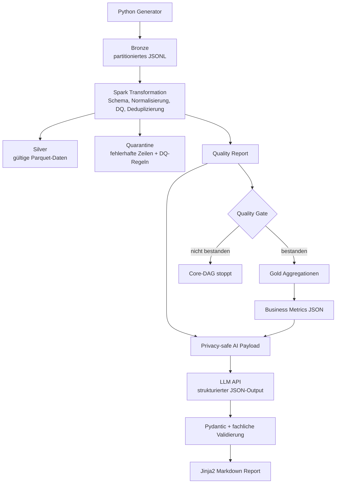

# Batch-Transaktionsdaten-Verarbeitung

[](https://github.com/Jakob-Benjamin-Dorn/Batch_Transaktionsdaten_Verarbeitung/actions/workflows/ci.yml)

Ein Portfolio-Projekt für eine tägliche, reproduzierbare Batch-Datenpipeline mit Python, Apache Spark, Apache Airflow, Docker und einer strukturierten KI-Zusammenfassung.

Das Projekt entstand aus der Motivation, einen vollständigen Data-Engineering-Workflow nicht nur theoretisch nachvollziehen zu können, sondern ihn auch praktisch umzusetzen und nachvollziehbar zu dokumentieren: von synthetischen Finanztransaktions-Rohdaten über Data Quality und Medallion-Architektur bis zur orchestrierten Berichterstellung.

## Was das Projekt demonstriert

Die Pipeline:

1. erzeugt reproduzierbare tägliche Transaktionsdaten,
2. schreibt unveränderte Rohdaten in einen partitionierten Bronze-Layer,
3. validiert, normalisiert und dedupliziert die Daten mit Spark,
4. trennt gültige Datensätze und Quarantänefälle,
5. prüft ein deterministisches Quality Gate,
6. erzeugt aggregierte Gold-Kennzahlen,
7. gibt ausschließlich freigegebene Aggregate an ein LLM weiter,
8. validiert dessen strukturierten JSON-Output,
9. rendert daraus deterministisch einen Markdown-Bericht,
10. orchestriert den Ablauf mit zwei getrennten Airflow-DAGs.

## Architektur



## Airflow-DAGs

### Core-DAG: `batch_transaction_pipeline`

```text
generate_bronze
→ transform_to_silver
→ evaluate_quality_gate
→ build_gold
→ prepare_ai_payload
→ trigger_ai_reporting_pipeline
```

Der Core-DAG enthält nur die deterministischen Datenverarbeitungsschritte. Er kann erfolgreich abgeschlossen werden, sobald der separate KI-DAG gestartet wurde.

### KI-DAG: `ai_reporting_pipeline`

```text
create_ai_summary
→ render_markdown
```

Der KI-DAG ist bewusst getrennt. Ist die externe API vorübergehend nicht erreichbar, werden nur die KI-Tasks wiederholt oder als fehlgeschlagen markiert. Bronze-, Silver-, Quarantine- und Gold-Daten bleiben davon unberührt.

Der Core-DAG verwendet:

```python
schedule="@daily"
catchup=False
max_active_runs=1
```

Dadurch werden beim ersten Aktivieren nicht automatisch alle historischen Tagesintervalle seit dem Startdatum nachgeholt.

## Warum diese Technologien?

### Docker

Airflow, Spark, Java und Python-Abhängigkeiten lokal konsistent zu betreiben ist fehleranfällig. Docker stellt eine reproduzierbare Laufzeitumgebung bereit, ohne dass Python, Java, Spark oder Airflow auf dem Host installiert werden müssen.

Quellcode und Konfiguration werden read-only eingebunden. Veränderliche Daten, Logs und Airflow-Zustände liegen in Named Volumes. Ein kurzlebiger `airflow-init`-Container richtet die Volumes als Root ein; der eigentliche Airflow-Service läuft anschließend unprivilegiert.

### Apache Spark

Für die derzeitige Datenmenge würde Pandas ausreichen. Spark wird bewusst verwendet, um eine skalierbare, schemaorientierte Verarbeitung mit DataFrames, Window Functions, Parquet und klar getrennten Daten-Layern zu demonstrieren.

### Apache Airflow

Airflow übernimmt Scheduling, Reihenfolge, Retries, Laufhistorie und Fehlerstatus. Die fachliche Logik bleibt in eigenständigen, testbaren CLI-Skripten. Die DAGs verwenden die moderne decorator-basierte TaskFlow-Schreibweise.

### KI-Zusammenfassung

Das LLM berechnet keine Kennzahlen und entscheidet nicht über Datenqualität. Spark und das Quality Gate liefern die Fakten. Die KI formuliert ausschließlich eine strukturierte Zusammenfassung aus aggregierten Metriken.

Der Ablauf ist kontrolliert:

```text
aggregierte Reports
→ feste Allowlist
→ LLM mit JSON-Ausgabe
→ Pydantic-Validierung
→ fachliche Validierung
→ Jinja2-Markdown
```

Der Provider ist perspektivisch austauschbar. Aktuell wird DeepSeek verwendet; ein Vergleich mit Mistral ist als spätere Erweiterung vorgesehen.

## Datenschutz

An die externe API werden keine Rohzeilen oder individuellen Identifikatoren übermittelt.

Nicht freigegeben sind unter anderem:

- `transaction_id`
- `customer_id`
- `merchant_id`
- `device_id`
- einzelne Zeitstempel
- einzelne Beträge
- Silver- oder Quarantine-Datensätze

Erlaubt sind ausschließlich aggregierte Kennzahlen, Regelbeschreibungen und technische Data-Quality-Metriken. Eine feste Allowlist sorgt dafür, dass neue Felder nicht automatisch in das KI-Payload gelangen.

API-Schlüssel werden ausschließlich über Umgebungsvariablen bereitgestellt und nicht in Git gespeichert.

## Medallion- und Report-Struktur

```text
/opt/airflow/data/
├── bronze_raw/
├── silver_processed/
├── quarantine/
├── gold_analytics/
└── reports/
```

Für einen erfolgreichen Tageslauf entstehen beispielsweise:

```text
reports/year=2026/month=01/day=02/
├── quality_report.json
├── business_metrics.json
├── ai_input_payload.json
├── ai_summary.json
└── ai_summary.md
```

## Projektstruktur

```text
.
├── airflow/
│   └── dags/
│       ├── batch_transaction_pipeline.py
│       └── ai_reporting_pipeline.py
├── src/
│   ├── generator/
│   │   └── generate_transactions.py
│   ├── spark/
│   │   ├── schemas.py
│   │   ├── data_quality.py
│   │   ├── transform_transactions.py
│   │   ├── evaluate_quality_gate.py
│   │   └── build_gold.py
│   └── ai_summary/
│       ├── prepare_payload.py
│       ├── models.py
│       ├── prompts.py
│       ├── create_ai_summary.py
│       ├── render_summary.py
│       └── templates/
│           └── summary.md.j2
├── knowledge_base/
│   └── data_contract.json
├── tests/
│   ├── unit/
│   ├── integration/
│   └── dags/
├── Dockerfile
├── docker-compose.yml
├── requirements.txt
└── .env.example
```

## Voraussetzungen

- Git
- Docker
- Docker Compose

## Schnellstart

### Repository klonen

```bash
git clone https://github.com/Jakob-Benjamin-Dorn/Batch_Transaktionsdaten_Verarbeitung.git
cd Batch_Transaktionsdaten_Verarbeitung
```

### Umgebungsvariablen

```bash
cp .env.example .env
```

Danach den API-Key ausschließlich lokal in `.env` ergänzen.

### Image bauen und Services starten

```bash
docker compose up --build -d
```

Bei späteren Starts ohne geänderte Abhängigkeiten:

```bash
docker compose up -d
```

Airflow ist anschließend erreichbar unter:

```text
http://localhost:8080
```

Beim lokalen Airflow-Setup mit Simple Auth Manager können die erzeugten Zugangsdaten beispielsweise so eingesehen werden:

```text
docker compose exec airflow \
  cat /opt/airflow/state/simple_auth_manager_passwords.json
```

### DAGs aktivieren

```bash
docker compose exec airflow \
  airflow dags unpause batch_transaction_pipeline
```

```bash
docker compose exec airflow \
  airflow dags unpause ai_reporting_pipeline
```

### Core-DAG für einen historischen Tag starten

Verwende ein Datum, für das noch kein DAG-Run existiert:

```bash
docker compose exec airflow \
  airflow dags trigger \
  --logical-date 2026-01-03T00:00:00+00:00 \
  batch_transaction_pipeline
```

### Runs kontrollieren

```bash
docker compose exec airflow \
  airflow dags list-runs batch_transaction_pipeline
```

```bash
docker compose exec airflow \
  airflow dags list-runs ai_reporting_pipeline
```

## Manuelle Ausführung einzelner Stufen

### Bronze

```bash
docker compose run --rm \
  --entrypoint python \
  airflow \
  /opt/airflow/src/generator/generate_transactions.py \
  --logical-date 2026-01-01 \
  --output-dir /opt/airflow/data
```

### Silver und Quarantine

```bash
docker compose run --rm \
  --entrypoint python \
  airflow \
  /opt/airflow/src/spark/transform_transactions.py \
  --logical-date 2026-01-01 \
  --data-dir /opt/airflow/data
```

### Quality Gate

```bash
docker compose run --rm \
  --entrypoint python \
  airflow \
  /opt/airflow/src/spark/evaluate_quality_gate.py \
  --logical-date 2026-01-01 \
  --data-dir /opt/airflow/data \
  --contract-path /opt/airflow/knowledge_base/data_contract.json
```

### Gold

```bash
docker compose run --rm \
  --entrypoint python \
  airflow \
  /opt/airflow/src/spark/build_gold.py \
  --logical-date 2026-01-01 \
  --data-dir /opt/airflow/data
```

### Datenschutzgeprüftes KI-Payload

```bash
docker compose run --rm \
  --entrypoint python \
  airflow \
  /opt/airflow/src/ai_summary/prepare_payload.py \
  --logical-date 2026-01-01 \
  --data-dir /opt/airflow/data \
  --contract-path /opt/airflow/knowledge_base/data_contract.json
```

### KI-Zusammenfassung

```bash
docker compose run --rm \
  --entrypoint python \
  airflow \
  /opt/airflow/src/ai_summary/create_ai_summary.py \
  --logical-date 2026-01-01 \
  --data-dir /opt/airflow/data
```

### Markdown rendern

```bash
docker compose run --rm \
  --entrypoint python \
  airflow \
  /opt/airflow/src/ai_summary/render_summary.py \
  --logical-date 2026-01-01 \
  --data-dir /opt/airflow/data
```

## Data Quality und Quality Gate

Der Data Contract definiert Schema, erlaubte Werte, Regelbeschreibungen und Severity. Aktuell werden zehn Data-Quality-Regeln geprüft, unter anderem:

- fehlende `customer_id`,
- ungültige `currency`,
- nicht parsebare oder zukünftige `event_time`,
- ungültige Purchase- und Refund-Beträge,
- ältere Duplikate pro `transaction_id`,
- ungültige `source_system`,
- fehlende `transaction_id`,
- fehlende oder nicht parsebare `ingestion_time`.

Das aktuelle Quality Gate stoppt den Core-DAG, wenn:

- der Batch keine Eingabezeilen enthält,
- die Validitätsrate unter 85 Prozent liegt,
- eine einzelne High-Severity-Regel mehr als 10 Prozent der Eingabezeilen betrifft.

Diese Schwellenwerte sind konfigurierbare Demo-Werte und keine allgemeinen Branchenstandards.

## Retry-Verhalten

| Task | Retries | Begründung |
|---|---:|---|
| `generate_bronze` | 1 | temporärer Dateisystemfehler möglich |
| `transform_to_silver` | 1 | temporäre Spark-/JVM-Probleme möglich |
| `evaluate_quality_gate` | 0 | deterministische Entscheidung |
| `build_gold` | 1 | temporäre Spark-Probleme möglich |
| `prepare_ai_payload` | 0 | deterministische lokale Verarbeitung |
| `trigger_ai_reporting_pipeline` | 0 | Orchestrierung |
| `create_ai_summary` | 3 | externe API, Netzwerk oder Rate Limit |
| `render_markdown` | 0 | deterministisches Rendering |

## Tests

Alle Unit-, Integrations- und DAG-Strukturtests:

```bash
docker compose run --rm \
  --entrypoint python \
  airflow \
  -m unittest discover \
  -s /opt/airflow/tests \
  -p "test_*.py" \
  -v
```

Die Tests prüfen unter anderem:

- deterministische Datenerzeugung,
- tägliche Partitionierung,
- simulierte Schema Drift,
- einzelne DQ-Regeln,
- Deduplizierung,
- Silver-/Quarantine-Split,
- Gold-Aggregationen,
- Quality Gate,
- Datenschutz-Allowlist,
- Pydantic-Modelle,
- KI-Response-Validierung,
- Markdown-Rendering,
- DAG-Struktur und Retry-Konfiguration.

## Ergebnisse anzeigen

```bash
docker compose run --rm \
  --entrypoint /bin/bash \
  airflow \
  -lc '
sed -n "1,220p" \
  /opt/airflow/data/reports/year=2026/month=01/day=02/ai_summary.md
'
```

## Services stoppen

Container stoppen, Daten behalten:

```bash
docker compose down
```

Container und Named Volumes vollständig löschen:

```bash
docker compose down -v
```

Achtung: Dadurch werden auch alle erzeugten Daten, Logs und die lokale Airflow-Datenbank entfernt.


## Continuous Integration

Das Projekt verwendet GitHub Actions für eine einfache CI-Pipeline.

Bei Pushes auf `main`, Pull Requests und manueller Ausführung wird:

1. das Docker-Image gebaut,
2. ein Dependency-Smoke-Test ausgeführt,
3. die komplette Unit-, Integrations- und DAG-Test-Suite im Container gestartet.

Der echte LLM-API-Aufruf ist bewusst nicht Teil der CI-Pipeline, da er externe Kosten, Secrets und mögliche Flakiness verursachen würde.


## Aktueller Stand

Implementiert:

- Dockerisierte und reproduzierbare Laufzeitumgebung
- synthetischer, deterministischer Tagesgenerator
- Bronze-, Silver-, Quarantine- und Gold-Layer
- explizites Spark-Schema und Data Contract
- zehn Data-Quality-Regeln inklusive Deduplizierung und Zeitstempelvalidierung
- konfigurierbares Quality Gate
- täglicher decorator-basierter Core-DAG
- separater KI-Reporting-DAG
- task-spezifische Retries
- Privacy-Allowlist
- strukturierte LLM-Ausgabe
- Pydantic- und fachliche Validierung
- deterministisches Markdown-Rendering
- automatisierte Unit-, Integrations- und DAG-Tests
- GitHub Actions CI für Docker-Build und automatisierte Tests

Mögliche nächste Schritte:

- Vergleich von DeepSeek und Mistral
- PostgreSQL und LocalExecutor für ein produktionsnäheres Airflow-Setup
- Alerting und Monitoring
- Cloud Object Storage statt lokalem Named Volume
- RAG mit internen Richtlinien oder Runbooks
- kontrollierter Human-in-the-loop-Workflow für Folgeaktionen

## Was ich dabei gelernt habe

Das Projekt hat mir vor allem gezeigt, dass eine Pipeline nicht nur aus einer erfolgreichen Transformation besteht. Reproduzierbarkeit, klare Datenverträge, nachvollziehbare Fehlerpfade, Tests, Orchestrierung, Datenschutz und die Trennung deterministischer Logik von externen KI-Komponenten sind mindestens genauso wichtig wie der eigentliche Spark-Code.
