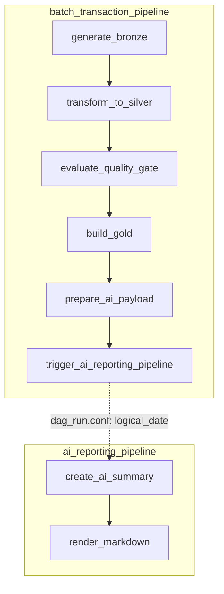
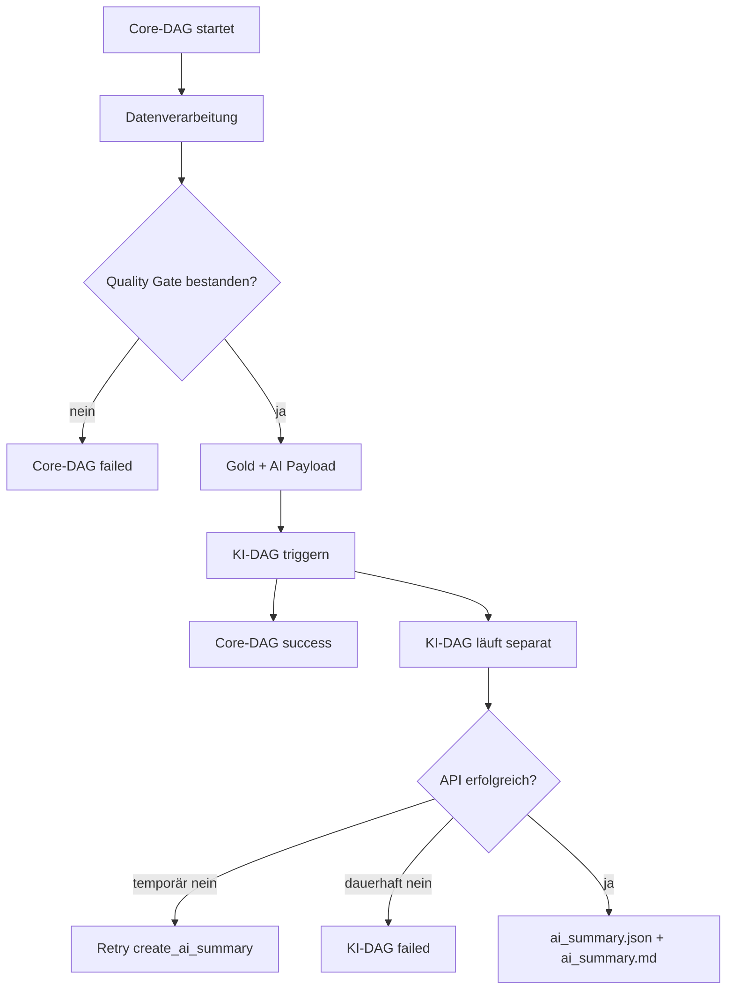

# Airflow-Orchestrierung

Dieser Ordner enthält die beiden DAGs, welche die Pipeline steuern:

```text
airflow/dags/
├── batch_transaction_pipeline.py
└── ai_reporting_pipeline.py
```

Die DAGs enthalten bewusst nur Orchestrierungslogik. Die eigentliche Fachlogik liegt in den CLI-Skripten unter `src/`. Dadurch bleiben Generator, Spark-Verarbeitung, Quality Gate und KI-Zusammenfassung auch unabhängig von Airflow testbar.

## Überblick



## Core-DAG: `batch_transaction_pipeline`

Der Core-DAG verarbeitet einen fachlichen Batch-Tag. Das Datum kommt aus `{{ ds }}` und wird an alle CLI-Skripte weitergegeben.

```text
generate_bronze
→ transform_to_silver
→ evaluate_quality_gate
→ build_gold
→ prepare_ai_payload
→ trigger_ai_reporting_pipeline
```

### Aufgaben

| Task | Skript | Aufgabe |
|---|---|---|
| `generate_bronze` | `src/generator/generate_transactions.py` | erzeugt den partitionierten Bronze-Batch |
| `transform_to_silver` | `src/spark/transform_transactions.py` | validiert, normalisiert, dedupliziert und trennt Silver/Quarantine |
| `evaluate_quality_gate` | `src/spark/evaluate_quality_gate.py` | prüft den Qualitätsbericht gegen Schwellenwerte aus dem Data Contract |
| `build_gold` | `src/spark/build_gold.py` | erzeugt Gold-Aggregationen und Business-Metriken |
| `prepare_ai_payload` | `src/ai_summary/prepare_payload.py` | erstellt ein datenschutzgeprüftes KI-Payload |
| `trigger_ai_reporting_pipeline` | `TriggerDagRunOperator` | startet den separaten KI-DAG |

Der Core-DAG nutzt:

```python
schedule="@daily"
catchup=False
max_active_runs=1
```

`catchup=False` ist hier wichtig: Beim Aktivieren des DAGs werden keine alten täglichen Intervalle seit dem Startdatum automatisch nachgeholt.

## KI-DAG: `ai_reporting_pipeline`

Der KI-DAG wird nicht zeitgesteuert gestartet. Er hat:

```python
schedule=None
catchup=False
```

Er wird vom Core-DAG ausgelöst und erhält das fachliche Batch-Datum über `dag_run.conf`.

```text
create_ai_summary
→ render_markdown
```

### Aufgaben

| Task | Skript | Aufgabe |
|---|---|---|
| `create_ai_summary` | `src/ai_summary/create_ai_summary.py` | ruft die DeepSeek-API auf und validiert den JSON-Output |
| `render_markdown` | `src/ai_summary/render_summary.py` | rendert aus dem validierten JSON einen Markdown-Bericht |

## Fehlerverhalten



Ein API-Fehler soll nicht die deterministische Datenpipeline als fehlgeschlagen markieren. Deshalb ist der KI-DAG getrennt.

## Retries

| Task | Retries | Grund |
|---|---:|---|
| `generate_bronze` | 1 | temporäre Dateisystemprobleme möglich |
| `transform_to_silver` | 1 | temporäre Spark-/JVM-Probleme möglich |
| `evaluate_quality_gate` | 0 | deterministische Entscheidung |
| `build_gold` | 1 | temporäre Spark-Probleme möglich |
| `prepare_ai_payload` | 0 | deterministische lokale Verarbeitung |
| `trigger_ai_reporting_pipeline` | 0 | Orchestrierungsschritt |
| `create_ai_summary` | 3 | externe API, Netzwerkfehler oder Rate Limits |
| `render_markdown` | 0 | deterministisches lokales Rendering |

## Nützliche Befehle

DAGs aktivieren:

```bash
docker compose exec airflow airflow dags unpause batch_transaction_pipeline
docker compose exec airflow airflow dags unpause ai_reporting_pipeline
```

Core-DAG manuell starten:

```bash
docker compose exec airflow \
  airflow dags trigger \
  --logical-date 2026-01-03T00:00:00+00:00 \
  batch_transaction_pipeline
```

Runs prüfen:

```bash
docker compose exec airflow airflow dags list-runs batch_transaction_pipeline
docker compose exec airflow airflow dags list-runs ai_reporting_pipeline
```

Importfehler prüfen:

```bash
docker compose exec airflow airflow dags list-import-errors
```
