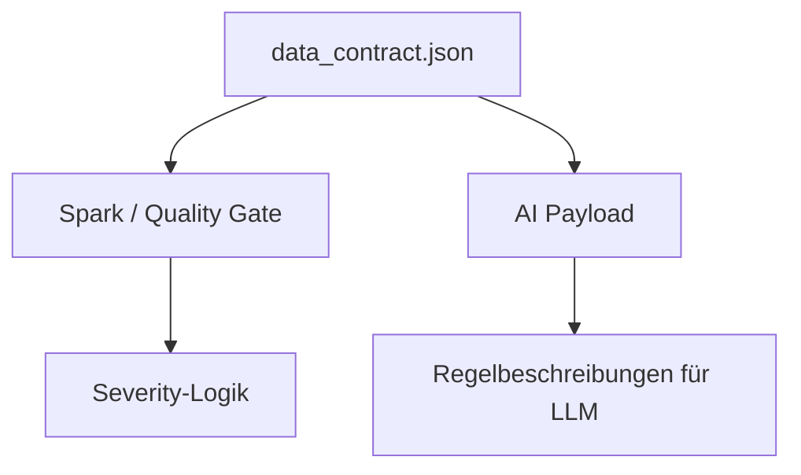

# Knowledge Base

Dieser Ordner enthält fachliche Konfigurations- und Kontextdateien für die Pipeline.

```text
knowledge_base/
└── data_contract.json
```

Der Data Contract ist die zentrale fachliche Beschreibung des Bronze-Batches. Er wird nicht nur zur Dokumentation verwendet, sondern auch vom Quality Gate und vom KI-Payload genutzt.

## Rolle in der Pipeline



## `data_contract.json`

Der Contract beschreibt:

- erwartete Felder,
- Zieltypen,
- Nullbarkeit,
- erlaubte Werte,
- Primärschlüssel,
- Data-Quality-Regeln,
- Severity pro Regel,
- Quality-Gate-Schwellenwerte.

## Felder

Der Contract beschreibt unter anderem:

- `transaction_id`
- `customer_id`
- `merchant_id`
- `device_id`
- `event_time`
- `ingestion_time`
- `amount`
- `currency`
- `transaction_country`
- `transaction_city`
- `payment_method`
- `transaction_type`
- `status`
- `is_refund`
- `is_fraud`
- `is_late_arriving`
- `source_system`
- `device_trust_score`

`device_trust_score` ist optional und bildet die simulierte Schema Drift ab.

## Quality Rules

Die Pipeline verwendet aktuell zehn DQ-Regeln:

| Regel | Severity | Bedeutung |
|---|---|---|
| `DQ001` | high | `customer_id` muss vorhanden sein |
| `DQ002` | medium | `currency` muss erlaubt sein |
| `DQ003` | high | `event_time` muss parsebar sein |
| `DQ004` | high | `event_time` darf nicht nach dem Batch-Datum liegen |
| `DQ005` | high | Purchase-Beträge müssen positiv sein |
| `DQ006` | high | Refunds brauchen negativen Betrag und passendes Refund-Flag |
| `DQ007` | medium | pro `transaction_id` darf nur die neueste Zeile in Silver bleiben |
| `DQ008` | low | `source_system` muss erlaubt sein |
| `DQ009` | high | `transaction_id` muss vorhanden sein |
| `DQ010` | high | `ingestion_time` muss vorhanden und parsebar sein |

Die kurzen IDs aus dem Contract werden im Quality Report als vollständige Regel-IDs geschrieben, zum Beispiel:

```text
DQ001_REQUIRED_CUSTOMER_ID
```

Das Quality Gate normalisiert diese vollständigen IDs wieder auf `DQ001`, um die Severity aus dem Contract zu lesen.

## Quality Gate

Aktuelle Schwellenwerte:

```json
{
  "minimum_validity_rate": 0.85,
  "maximum_high_severity_failure_rate": 0.1
}
```

Der Core-DAG stoppt, wenn:

- der Batch leer ist,
- die Validitätsrate unter 85 Prozent liegt,
- eine einzelne High-Severity-Regel mehr als 10 Prozent der Eingabezeilen betrifft.

## Nutzung im KI-Payload

`prepare_payload.py` übernimmt aus dem Contract nur freigegebene Felder und Regelbeschreibungen. Dadurch kann das LLM die fachliche Bedeutung der DQ-Regeln erklären, ohne Zugriff auf einzelne Transaktionen oder IDs zu erhalten.
