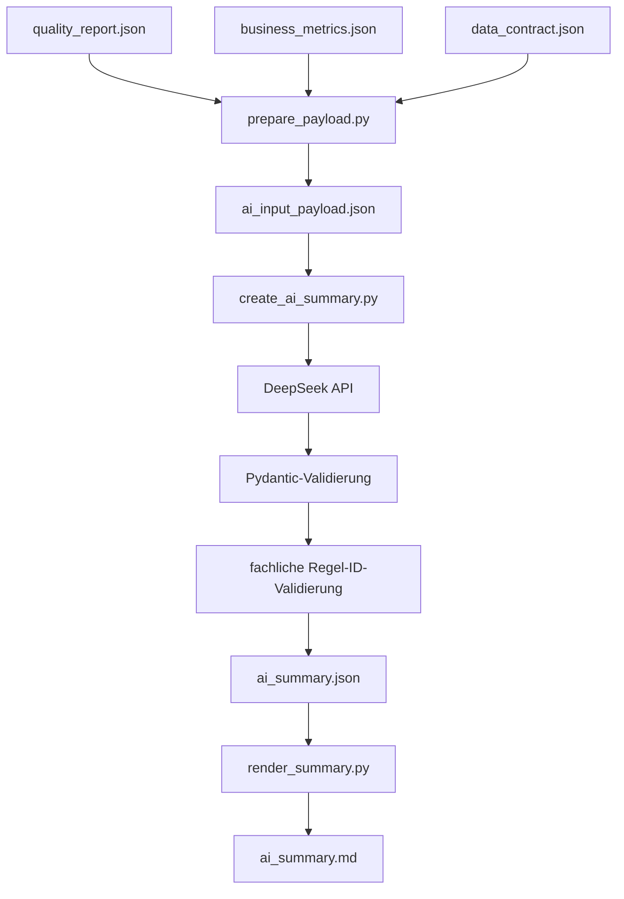
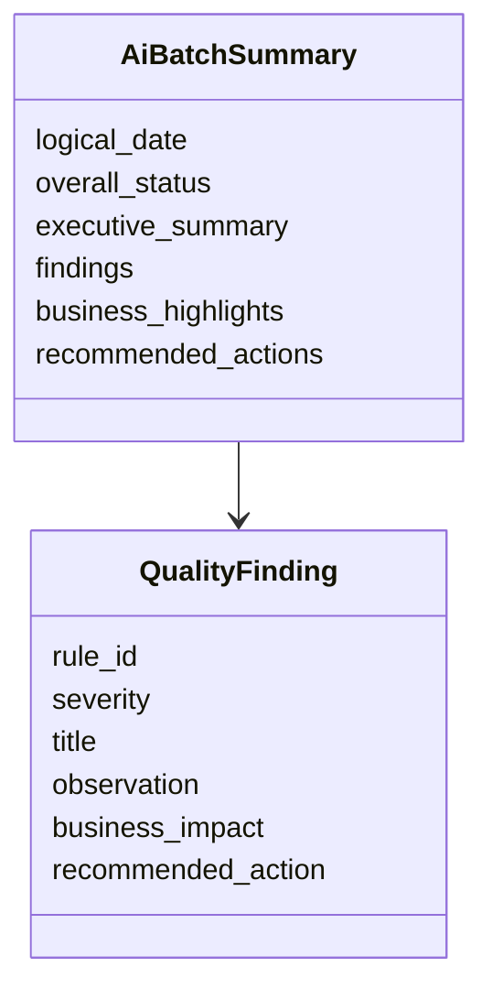

# KI-Zusammenfassung

Dieser Ordner enthält die KI-Komponente der Pipeline.

```text
src/ai_summary/
├── prepare_payload.py
├── prompts.py
├── models.py
├── create_ai_summary.py
├── render_summary.py
└── templates/
    └── summary.md.j2
```

Die KI-Komponente erzeugt keine Kennzahlen selbst. Sie fasst ausschließlich bereits berechnete und freigegebene Aggregate zusammen.

## Überblick



## `prepare_payload.py`

Dieses Skript erstellt das datenschutzgeprüfte Input-Payload für die KI.

Inputs:

```text
quality_report.json
business_metrics.json
data_contract.json
```

Output:

```text
ai_input_payload.json
```

### Datenschutzlogik

Es werden nur explizit erlaubte Felder übernommen. Zusätzlich prüft `find_forbidden_keys()`, ob verbotene Schlüssel im Payload vorkommen.

Nicht erlaubt sind zum Beispiel einzelne IDs oder zeilennahe Felder wie:

- `transaction_id`
- `customer_id`
- `merchant_id`
- `device_id`
- einzelne Zeitstempel
- rohe Datensätze

Das Payload enthält außerdem `pipeline_capabilities`, damit das Modell weiß, dass die Pipeline bereits quarantänisiert, dedupliziert und Silver nur gültige Zeilen enthält.

## `prompts.py`

`prompts.py` enthält den System-Prompt und die Erzeugung des User-Prompts.

Zentrale Prompt-Vorgaben:

- Ausgabe auf Deutsch
- Ausgabe als JSON
- keine erfundenen Ursachen
- vollständige Regel-IDs aus `rule_failures`
- Refund nicht als Chargeback bezeichnen
- synthetisches Fraud-Label nicht als bestätigte Betrugserkennung darstellen
- globale Mehrwährungsbeträge nicht als einheitlichen Umsatz darstellen
- nicht empfehlen, Quarantine oder Deduplizierung erst einzuführen, weil die Pipeline das bereits tut

## `models.py`

`models.py` definiert die erwartete JSON-Struktur mit Pydantic.



Beide Modelle verbieten zusätzliche Felder über `extra="forbid"`. Dadurch wird verhindert, dass das Modell ungeplante JSON-Strukturen liefert.

## `create_ai_summary.py`

Dieses Skript ruft die DeepSeek-API über den OpenAI-kompatiblen Client auf.

Wichtige Schritte:

1. `ai_input_payload.json` laden
2. `DEEPSEEK_API_KEY`, Modell und Base URL aus Umgebungsvariablen lesen
3. DeepSeek mit JSON-Modus aufrufen
4. Antwort als JSON parsen
5. mit `AiBatchSummary` validieren
6. `logical_date` gegen den erwarteten Batch-Tag prüfen
7. Finding-Regel-IDs gegen `quality_report.rule_failures` prüfen
8. Findings nach Severity und Fehleranzahl sortieren
9. `ai_summary.json` schreiben

Output:

```text
/opt/airflow/data/reports/year=YYYY/month=MM/day=DD/ai_summary.json
```

## `render_summary.py`

Dieses Skript erzeugt aus dem validierten JSON einen deterministischen Markdown-Bericht.

Input:

```text
ai_summary.json
```

Template:

```text
templates/summary.md.j2
```

Output:

```text
ai_summary.md
```

Das Rendering nutzt `StrictUndefined`. Wenn ein erwartetes Template-Feld fehlt, schlägt das Rendering dadurch bewusst fehl, statt still einen unvollständigen Bericht zu erzeugen.

## Manuelle Ausführung

Payload erstellen:

```bash
docker compose run --rm \
  --entrypoint python \
  airflow \
  /opt/airflow/src/ai_summary/prepare_payload.py \
  --logical-date 2026-01-01 \
  --data-dir /opt/airflow/data \
  --contract-path /opt/airflow/knowledge_base/data_contract.json
```

KI-Zusammenfassung erstellen:

```bash
docker compose run --rm \
  --entrypoint python \
  airflow \
  /opt/airflow/src/ai_summary/create_ai_summary.py \
  --logical-date 2026-01-01 \
  --data-dir /opt/airflow/data
```

Markdown rendern:

```bash
docker compose run --rm \
  --entrypoint python \
  airflow \
  /opt/airflow/src/ai_summary/render_summary.py \
  --logical-date 2026-01-01 \
  --data-dir /opt/airflow/data
```

## Rolle in Airflow

Der Core-DAG erstellt nur das Payload. Der eigentliche API-Aufruf läuft im separaten `ai_reporting_pipeline`-DAG. Dadurch bleiben externe API-Ausfälle von der deterministischen Datenverarbeitung getrennt.
