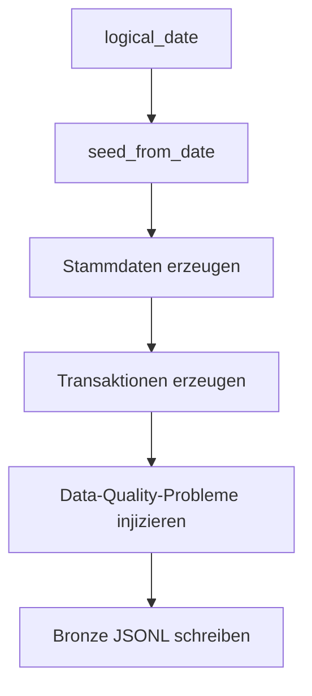
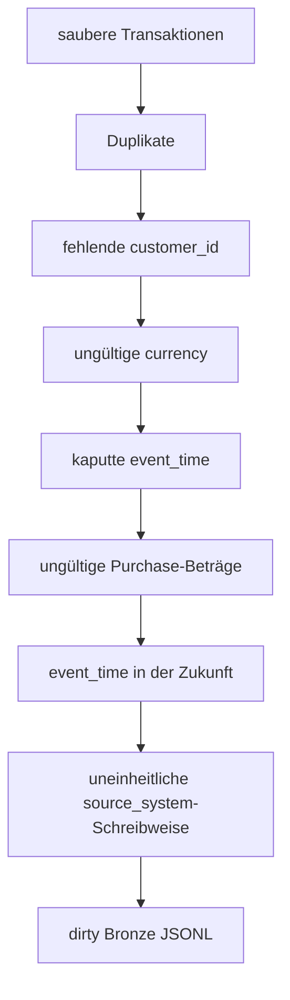

# Synthetischer Datengenerator

Dieser Ordner enthält den Generator für tägliche Bronze-Daten:

```text
src/generator/generate_transactions.py
```

Der Generator erzeugt synthetische Transaktionsdaten für genau einen logischen Batch-Tag. Für dasselbe Datum wird immer derselbe Seed abgeleitet. Dadurch sind Testläufe reproduzierbar.

## Rolle in der Pipeline



Output:

```text
/opt/airflow/data/bronze_raw/transactions/
└── year=YYYY/
    └── month=MM/
        └── day=DD/
            └── transactions.jsonl
```

## Wichtige Funktionen

| Funktion | Zweck |
|---|---|
| `seed_from_date()` | erzeugt einen stabilen Seed aus `logical_date` und Basis-Seed |
| `generate_customers()` | erzeugt synthetische Kundenstammdaten |
| `generate_merchants()` | erzeugt Händler mit Kategorien und Risikomerkmalen |
| `generate_devices()` | erzeugt Geräte pro Kunde |
| `generate_exchange_rates()` | erzeugt unterstützende Wechselkursdaten für die Simulation |
| `generate_transactions()` | erzeugt Transaktionen für den Batch-Tag |
| `generate_chargebacks()` | erzeugt unterstützende Chargeback-Daten für Diagnoseausgaben |
| `inject_data_quality_issues()` | injiziert absichtlich fehlerhafte Werte |
| `save_bronze_batch()` | schreibt den Bronze-Batch als JSONL |

Die unterstützenden Entitäten wie Kunden, Händler, Geräte, Wechselkurse und Chargebacks werden für die Simulation erzeugt und im Terminal zusammengefasst. Persistiert wird aktuell der Bronze-Transaktionsbatch.

## Simulierte Datenlogik

Die Transaktionen enthalten unter anderem:

- `transaction_id`
- `customer_id`
- `merchant_id`
- `device_id`
- `event_time`
- `ingestion_time`
- `amount`
- `currency`
- `transaction_country`
- `transaction_city`
- `payment_method`
- `transaction_type`
- `status`
- `is_refund`
- `is_fraud`
- `is_late_arriving`
- `source_system`
- optional `device_trust_score`

Ab dem konfigurierten Schema-Drift-Datum `2026-01-20` kann zusätzlich `device_trust_score` entstehen.

## Injektion von Data-Quality-Problemen



Die aktuellen Generatorfehler decken nicht jede DQ-Regel ab. Einige Regeln werden gezielt über Unit- und Integrationstests geprüft, zum Beispiel fehlende `transaction_id` oder ungültige `ingestion_time`.

## Manuelle Ausführung

```bash
docker compose run --rm \
  --entrypoint python \
  airflow \
  /opt/airflow/src/generator/generate_transactions.py \
  --logical-date 2026-01-01 \
  --output-dir /opt/airflow/data
```

## Interaktion mit anderen Komponenten

Der Generator schreibt nur Bronze-Daten. Er validiert die Daten nicht. Die Validierung erfolgt später in Spark:

```text
generate_transactions.py
→ bronze_raw JSONL
→ transform_transactions.py
```

Diese Trennung ist bewusst: Bronze soll rohe Eingabedaten möglichst unverändert aufnehmen.
