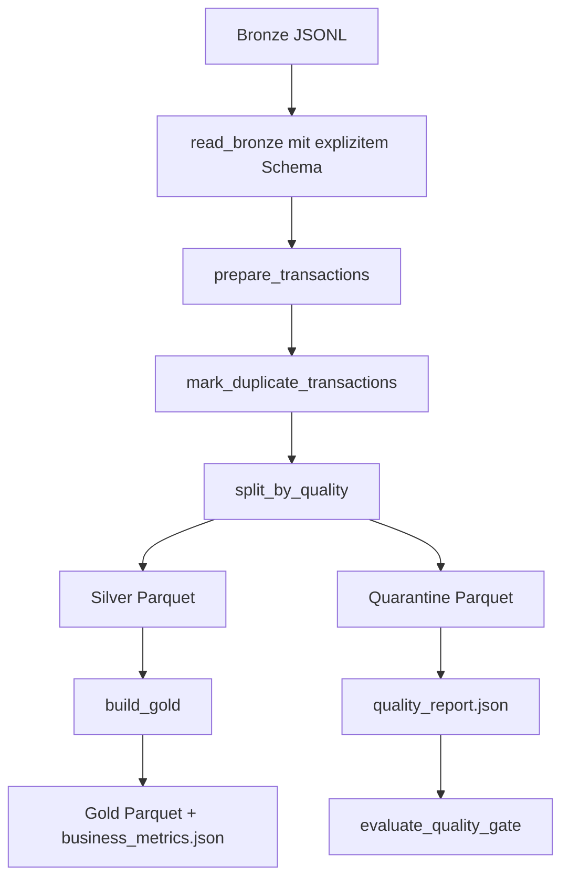
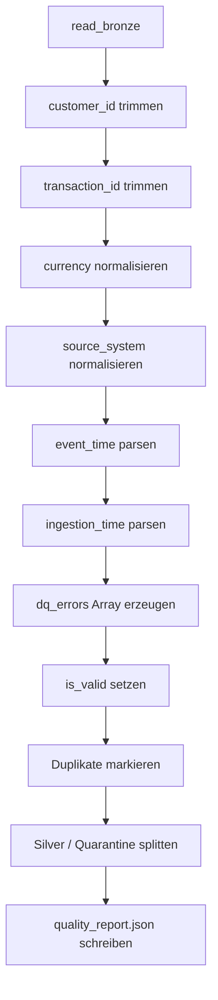
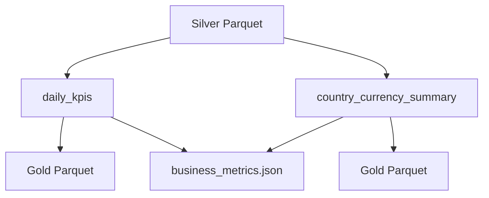

# Spark-Verarbeitung

Dieser Ordner enthält die Spark-basierte Verarbeitung der Bronze-, Silver-, Quarantine- und Gold-Schichten.

```text
src/spark/
├── schemas.py
├── data_quality.py
├── transform_transactions.py
├── evaluate_quality_gate.py
└── build_gold.py
```

## Überblick



## `schemas.py`

`schemas.py` definiert das Bronze-Schema für Spark.

Wichtig: `event_time` und `ingestion_time` werden im Bronze-Schema als Strings gelesen. Dadurch gehen absichtlich beschädigte Werte wie `not-a-timestamp` nicht beim Einlesen verloren. Erst in `transform_transactions.py` werden sie mit `try_to_timestamp()` geparst.

## `data_quality.py`

`data_quality.py` enthält die wiederverwendbaren DQ-Regeln als Spark-Column-Ausdrücke.

Aktuelle Regeln:

| Regel | Bedeutung |
|---|---|
| `DQ001_REQUIRED_CUSTOMER_ID` | `customer_id` fehlt oder ist leer |
| `DQ002_INVALID_CURRENCY` | Währung ist nicht `EUR`, `USD`, `GBP` oder `PLN` |
| `DQ003_INVALID_EVENT_TIME` | `event_time` kann nicht geparst werden |
| `DQ004_EVENT_TIME_IN_FUTURE` | `event_time` liegt nach dem Batch-Datum |
| `DQ005_INVALID_PURCHASE_AMOUNT` | Purchase hat keinen positiven Betrag |
| `DQ006_INVALID_REFUND` | Refund hat keinen negativen Betrag oder `is_refund` passt nicht |
| `DQ007_DUPLICATE_TRANSACTION` | ältere Zeile einer mehrfach vorkommenden `transaction_id` |
| `DQ008_INVALID_SOURCE_SYSTEM` | normalisiertes `source_system` ist nicht erlaubt |
| `DQ009_REQUIRED_TRANSACTION_ID` | `transaction_id` fehlt oder ist leer |
| `DQ010_INVALID_INGESTION_TIME` | `ingestion_time` fehlt oder kann nicht geparst werden |

Die Duplikatregel ist als eigene Funktion umgesetzt, weil sie eine Window Function benötigt. Pro `transaction_id` bleibt die Zeile mit der neuesten `ingestion_time_parsed` gültig; ältere Zeilen werden mit `DQ007_DUPLICATE_TRANSACTION` markiert.

## `transform_transactions.py`

Dieses Skript ist die zentrale Bronze-zu-Silver-Transformation.

### Ablauf



### Output

Silver:

```text
/opt/airflow/data/silver_processed/transactions/year=YYYY/month=MM/day=DD/
```

Quarantine:

```text
/opt/airflow/data/quarantine/transactions/year=YYYY/month=MM/day=DD/
```

Quality Report:

```text
/opt/airflow/data/reports/year=YYYY/month=MM/day=DD/quality_report.json
```

Silver enthält keine DQ-Hilfsspalten wie `dq_errors`, `is_valid` oder `duplicate_rank`. Quarantine enthält diese Informationen bewusst, damit Regelverletzungen nachvollziehbar bleiben.

## `evaluate_quality_gate.py`

Das Quality Gate liest:

```text
quality_report.json
data_contract.json
```

und bewertet den Batch gegen die Schwellenwerte aus dem Contract.

Aktuelle Logik:

- keine Eingabezeilen → Fehler
- Validitätsrate unter `minimum_validity_rate` → Fehler
- High-Severity-Regel mit Fehlerrate über `maximum_high_severity_failure_rate` → Fehler

Das Skript normalisiert die ausführlichen Report-Regel-IDs wie `DQ001_REQUIRED_CUSTOMER_ID` auf die kurzen Contract-IDs wie `DQ001`, um die Severity aus dem Contract zu finden.

## `build_gold.py`

`build_gold.py` liest Silver-Daten und erzeugt aggregierte analytische Outputs.



Berechnete Kennzahlen sind unter anderem:

- Anzahl gültiger Transaktionen
- genehmigte, abgelehnte und ausstehende Transaktionen
- Purchase- und Refund-Anzahl
- synthetische Fraud- und Late-Arrival-Anzahl
- Purchase-, Refund- und Nettobeträge
- durchschnittlicher genehmigter Purchase-Betrag
- Fraud-, Refund- und Approval-Rate
- Länder-/Währungsaggregate

Wichtig: Beträge werden nicht in eine einheitliche Währung umgerechnet. Deshalb werden globale Beträge vorsichtig verwendet und im KI-Prompt nicht als einheitlicher Umsatz interpretiert.

## Manuelle Ausführung

Transformation:

```bash
docker compose run --rm \
  --entrypoint python \
  airflow \
  /opt/airflow/src/spark/transform_transactions.py \
  --logical-date 2026-01-01 \
  --data-dir /opt/airflow/data
```

Quality Gate:

```bash
docker compose run --rm \
  --entrypoint python \
  airflow \
  /opt/airflow/src/spark/evaluate_quality_gate.py \
  --logical-date 2026-01-01 \
  --data-dir /opt/airflow/data \
  --contract-path /opt/airflow/knowledge_base/data_contract.json
```

Gold:

```bash
docker compose run --rm \
  --entrypoint python \
  airflow \
  /opt/airflow/src/spark/build_gold.py \
  --logical-date 2026-01-01 \
  --data-dir /opt/airflow/data
```
