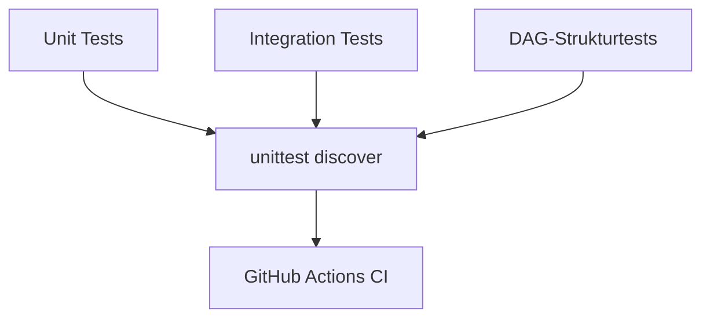

# Tests

Dieser Ordner enthält Unit-, Integrations- und DAG-Strukturtests.

```text
tests/
├── unit/
├── integration/
└── dags/
```

Die Tests laufen im Docker-/Airflow-Container. Dadurch verwenden sie dieselbe Python-, Spark- und Airflow-Umgebung wie die Pipeline.

## Überblick



## Unit-Tests

Die Unit-Tests prüfen einzelne Bausteine möglichst isoliert.

Beispiele:

| Datei | Prüft |
|---|---|
| `test_generator.py` | Seed-Reproduzierbarkeit, JSONL-Ausgabe, Schema Drift |
| `test_data_quality.py` | einzelne Spark-DQ-Regeln und Deduplizierung |
| `test_gold_aggregations.py` | Berechnung der Gold-Kennzahlen |
| `test_quality_gate.py` | Pass-/Fail-Logik des Quality Gates |
| `test_ai_payload.py` | Allowlist und Schutz vor verbotenen Feldern |
| `test_ai_models.py` | Pydantic-Struktur der KI-Antwort |
| `test_create_ai_summary.py` | Validierung der KI-Antwort und Regel-IDs |
| `test_render_summary.py` | deterministisches Markdown-Rendering |

## Integrationstests

`tests/integration/test_spark_transform.py` prüft die gemeinsame Spark-Verarbeitung:

```text
Bronze-Zeilen
→ prepare_transactions
→ mark_duplicate_transactions
→ split_by_quality
→ Silver und Quarantine
```

Der Test validiert unter anderem:

- gültige Zeilen landen in Silver,
- ungültige Zeilen landen in Quarantine,
- ältere Duplikate werden markiert,
- Silver enthält keine DQ-Hilfsspalten,
- normalisierte Felder werden korrekt geschrieben,
- ungültige `ingestion_time` wird quarantänisiert.

## DAG-Strukturtests

`tests/dags/test_dag_structure.py` lädt die DAG-Dateien direkt und prüft:

- beide DAGs sind importierbar,
- erwartete Task-IDs existieren,
- Abhängigkeiten stimmen,
- `catchup=False` ist gesetzt,
- Retries entsprechen der gewünschten Strategie.

Dadurch werden Airflow-Fehler früh erkannt, ohne einen vollständigen DAG-Run starten zu müssen.

## Tests ausführen

Alle Tests:

```bash
docker compose run --rm \
  --entrypoint python \
  airflow \
  -m unittest discover \
  -s /opt/airflow/tests \
  -p "test_*.py" \
  -v
```

Nur Unit-Tests:

```bash
docker compose run --rm \
  --entrypoint python \
  airflow \
  -m unittest discover \
  -s /opt/airflow/tests/unit \
  -p "test_*.py" \
  -v
```

Nur Integrationstest:

```bash
docker compose run --rm \
  --entrypoint python \
  airflow \
  -m unittest tests.integration.test_spark_transform -v
```

Nur DAG-Strukturtests:

```bash
docker compose run --rm \
  --entrypoint python \
  airflow \
  -m unittest tests.dags.test_dag_structure -v
```

## GitHub Actions

Die CI-Pipeline baut das Docker-Image und führt die Tests im Container aus. Ein echter DeepSeek-Aufruf ist bewusst nicht Teil der CI, weil er Secrets, externe Kosten und mögliche Flakiness verursachen würde.
